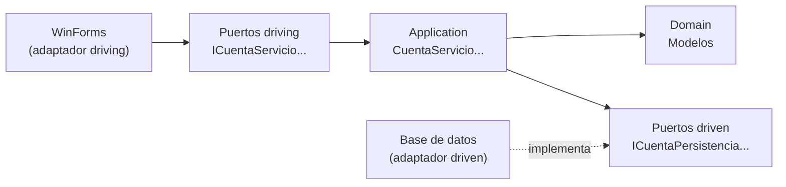

# Finanzas — Gestor de finanzas personales

Aplicación de escritorio para gestionar finanzas personales: cuentas, ingresos y gastos por categoría, y presupuestos mensuales.

El objetivo del proyecto es aplicar **arquitectura hexagonal (puertos y adaptadores)** e **inyección de dependencias** en una aplicación de escritorio con .NET.

> 🚧 **En desarrollo.** Este README refleja el estado actual del proyecto.

## Tecnologías

- **.NET 10** y **C#**
- **Windows Forms** para la interfaz
- **FluentResults** para gestionar errores sin excepciones
- **Microsoft.Extensions.Logging** para el registro de eventos
- **Microsoft.Extensions.DependencyInjection** para la inyección de dependencias *(pendiente)*
- Base de datos local *(pendiente)*

## Arquitectura

El núcleo de la aplicación (modelos y reglas de negocio) no conoce ni la interfaz ni la base de datos. Se comunica con el exterior únicamente a través de **puertos** (interfaces), que implementan los **adaptadores**.



- **Puertos driving (de entrada):** lo que la aplicación ofrece a la interfaz (crear una cuenta, registrar un movimiento...).
- **Puertos driven (de salida):** lo que la aplicación necesita del exterior (guardar y consultar datos).
- **Servicios:** implementan los puertos driving, aplican las reglas de negocio y reciben los puertos driven por **inyección de dependencias**.

Todas las operaciones devuelven `Result` / `Result<T>` de FluentResults, así la interfaz recibe los errores de negocio como resultados en lugar de tener que capturar excepciones.

## Estructura del proyecto

```
App_Escritorio/
├─ Domain/
│  ├─ Model/
│  │  ├─ Comun/DomainException.cs
│  │  ├─ Cuenta.cs
│  │  ├─ Categoria.cs
│  │  ├─ Movimiento.cs
│  │  └─ Presupuesto.cs
│  └─ Ports/
│     ├─ Driven/      ← ICuentaPersistencia, ICategoriaPersistencia, ...
│     └─ Driving/     ← ICuentaServicio, ICategoriaServicio, ...
├─ Application/
│  ├─ CuentaServicio.cs
│  ├─ CategoriaServicio.cs
│  ├─ MovimientoServicio.cs
│  └─ PresupuestoServicio.cs
├─ Form1.cs
└─ Program.cs
```

## Modelo de dominio

| Entidad | Descripción |
|---|---|
| `Cuenta` | Cuenta con nombre, saldo y tipo (Banco, Efectivo, Ahorro, Crédito) |
| `Categoria` | Categoría de movimiento, de tipo Ingreso o Gasto |
| `Movimiento` | Ingreso o gasto asociado a una cuenta y una categoría |
| `Presupuesto` | Límite de gasto para una categoría en un mes concreto |

## Reglas de negocio

Las reglas viven en los servicios de la capa Application. Todas se comprueban **antes** de escribir nada en la base de datos.

**Cuentas**
- El nombre es obligatorio y el saldo inicial no puede ser negativo.
- El saldo solo cambia a través de los movimientos.

**Categorías**
- El nombre es obligatorio.
- Cada categoría es de ingreso o de gasto.

**Movimientos**
- El importe debe ser mayor que cero.
- La cuenta y la categoría deben existir.
- El tipo (ingreso o gasto) lo determina la categoría, no se indica a mano.
- Un gasto resta del saldo y un ingreso suma.
- Una cuenta no puede quedarse en negativo, **salvo que sea de tipo Crédito**.

**Presupuestos**
- El límite debe ser mayor que cero y el mes, válido (1–12).
- Solo se pueden definir para categorías de gasto.
- Hay un único presupuesto por categoría y mes: si ya existe, se actualiza su límite.
- Lo gastado se calcula sumando los gastos de la categoría en ese mes.

## Estado

- [x] Modelos de dominio
- [x] Puertos driving y driven con `Result`
- [x] Servicios de cuentas, categorías, movimientos y presupuestos
- [ ] Revertir el saldo al eliminar un movimiento
- [ ] Adaptador de persistencia (base de datos local)
- [ ] Configuración de la inyección de dependencias
- [ ] Interfaz: cuentas, movimientos, presupuestos y dashboard
- [ ] Tests unitarios

## Ejecución

Requisitos: Windows y el [SDK de .NET 10](https://dotnet.microsoft.com/download).

```bash
git clone <url-del-repositorio>
cd App_Escritorio
dotnet run --project App_Escritorio
```
